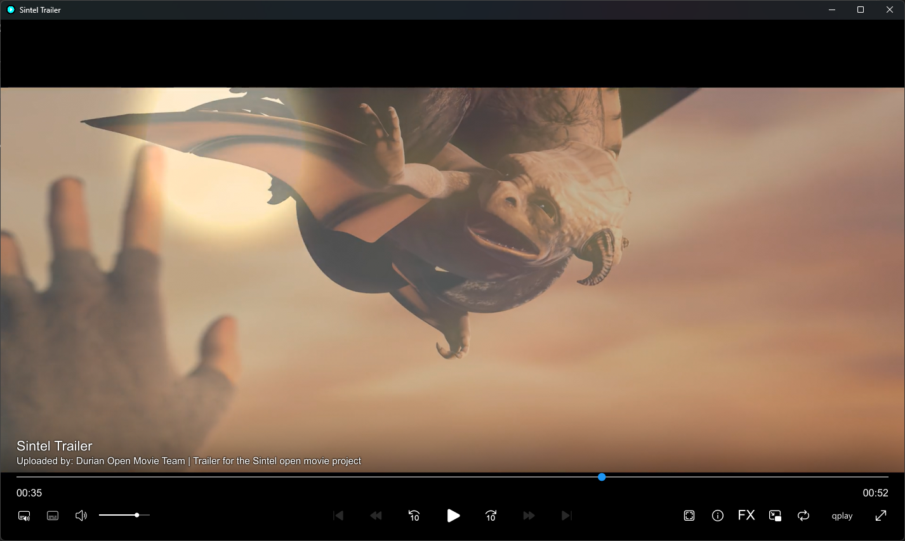

<p align="center">
  <a href="README.md">Русский</a> / <strong>English</strong>
</p>

<h1 align="center">qplay</h1>

<p align="center">
  A video player based on <a href="https://mpv.io/">mpv</a>.
</p>

<p align="center">
  <a href="https://github.com/qbutt-org/qplay/releases/latest/download/qplay-setup.exe">
    
  </a>
  <a href="https://github.com/qbutt-org/qplay/releases">
    
  </a>
</p>

<p align="center">
  
  <a href="https://github.com/qbutt-org/qplay/releases/latest">
    
  </a>
  <a href="LICENSE">
    
  </a>
</p>

<p align="center">
  <a href="https://qbutt-org.github.io/qplay/en/">Website</a> /
  <a href="https://github.com/qbutt-org/qplay/releases/latest/download/qplay-portable.zip">Portable</a>
</p>

<p align="center">
  
  <br>
  <sub>Frame from Sintel. © Blender Foundation / <a href="https://durian.blender.org/">durian.blender.org</a>, <a href="https://creativecommons.org/licenses/by/3.0/">CC BY 3.0</a>.</sub>
</p>

## Installation

### Windows

Run **qplay-setup.exe**. qplay supports Windows 10 version 2004 or later and Windows 11, x64. qplay appears in the Start menu and the Windows apps list.

For the portable version, extract **qplay-portable.zip** and run `qplay.exe`.

The installed version downloads updates in the background and installs them after all player windows close. The portable version is updated manually from settings.

Open a media file or a direct URL in the player window. qplay appears in the Windows **Open with** menu for common video and audio formats. It does not change your default player.

### Linux

Linux x64 requires Ubuntu 24.04 or later with glibc 2.39+. Run this in a Linux or WSL terminal:

```sh
curl -fsSL https://qbutt-org.github.io/qbutt/install.sh | sh -s -- qplay
```

After installation, open qplay from the applications menu or run `~/.local/bin/qplay`.

For manual installation, download [qplay-linux-x64.tar.gz](https://github.com/qbutt-org/qplay/releases/latest/download/qplay-linux-x64.tar.gz), extract it, and run `./qplay --install`. Run `./qplay` without installation for a portable instance with its profile in `userdata`.

Close the player before updating and repeat the installation command. `~/.local/bin/qplay --uninstall` removes the app while preserving settings and playback data.

## Controls and image quality

The settings button at the bottom right opens audio tracks, subtitles, playback speed, and image processing. Upscaling depends on the GPU and video; frame generation is available only on Windows.

You can turn subtitles off, choose a track from the video, or add a separate subtitle file. The player remembers where you stopped and resumes when you reopen the video.

Basic playback works offline from the installed bundle. On Windows, frame generation may download additional components automatically.

## qbutt and qcatch

[qbutt](https://github.com/qbutt-org/qbutt) uses qplay for online video and watching torrent files while they download. The qbutt installer installs the same player.

[qcatch](https://github.com/qbutt-org/qcatch) finds video in the browser and opens the selected stream in the installed qplay.

## Settings

On Windows, the installed version stores settings in `%APPDATA%\qplay`, and caches and prepared GPU components in `%LOCALAPPDATA%\qplay`. Linux uses XDG directories, defaulting to `~/.config/qplay`, `~/.local/share/qplay`, and `~/.cache/qplay` for settings, data, and cache. The portable version uses the `userdata` folder next to the app. Existing mpv and mpv.net settings are not replaced.

Advanced settings include language, appearance, and a persistent audio delay relative to video. Your image processing choice survives a restart.

## Development

The native player lives in `src/native/`. QML owns the interface; Rust owns the libmpv session and settings. Pinned dependencies and runtime provenance are recorded in `upstream-lock.json`.

Local builds require Qt 6.12, CMake, the Rust toolchain from `rust-toolchain.toml`, and Bun. Windows also requires MSVC and Inno Setup 6.7.3. Configure the CMake build, then run this from Developer PowerShell with your build directory:

```powershell
bun scripts/build.ts --native-build "C:\build\qplay-native" --installer-compiler "C:\tools\Inno Setup 6\ISCC.exe"
```

The script checks the native build source revision, rebuilds changed files, verifies the pinned runtime, deploys Qt/QML, and creates the installer and portable archive in `%TEMP%\qplay-build`. Use `--runtime-archive` for a downloaded archive and `--output` for another result directory.

On Linux, `scripts/build-linux-runtime.ts` prepares the pinned media engine, and `scripts/build-linux.ts` packages the CMake build as `qplay-linux-x64.zip`. Packaging requires `--native-build`, `--linux-runtime`, and `--qt-licenses`; `--output` sets the result directory. `scripts/build-linux-sources.ts` builds the complete runtime source archive.

`qplay --version-json` and `qplay --runtime-info-json` return integration metadata; the Windows executable is `qplay.exe`. The player accepts a file path or URL as one argument.

See the [project rules](AGENTS.md).

## Licenses and provenance

The bundle includes the Qt interface, shaders, and media dependencies with their authors' notices. Licenses are in [licenses/](licenses/), and qplay source terms are in [LICENSE](LICENSE).

qplay source is available from the corresponding release tag. Exact media engine and dependency sources are provided in a separate technical release linked from the product release description.
