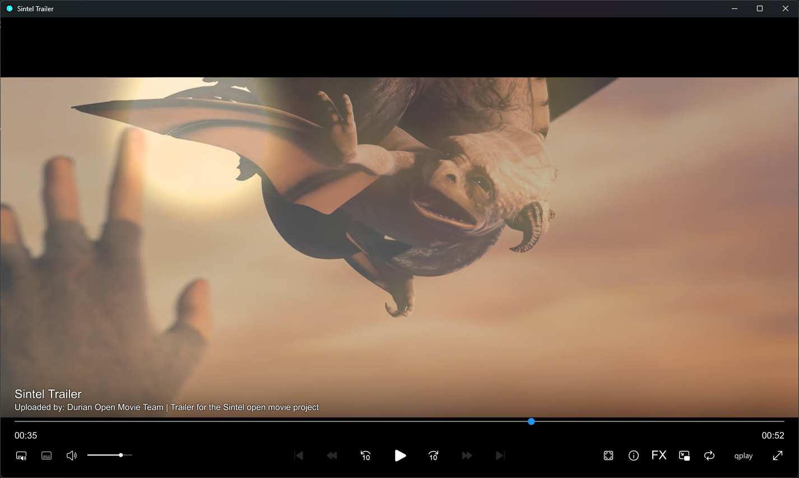

<p align="center">
  <a href="README.md">Русский</a> / <strong>English</strong>
</p>

<h1 align="center">qplay</h1>

<p align="center">
  A video player based on <a href="https://mpv.io/">mpv</a>.
</p>

<p align="center">
  <a href="https://github.com/qbutt-org/qplay/releases/latest/download/qplay-setup.exe">
    
  </a>
  <a href="https://github.com/qbutt-org/qplay/releases">
    
  </a>
</p>

<p align="center">
  
  <a href="https://github.com/qbutt-org/qplay/releases/latest">
    
  </a>
  <a href="LICENSE">
    
  </a>
</p>

<p align="center">
  <a href="https://qbutt-org.github.io/qplay/en/">Website</a> /
  <a href="https://github.com/qbutt-org/qplay/releases/latest/download/qplay-portable.zip">Portable</a>
</p>

<p align="center">
  
  <br>
  <sub>Frame from Sintel. © Blender Foundation / <a href="https://durian.blender.org/">durian.blender.org</a>, <a href="https://creativecommons.org/licenses/by/3.0/">CC BY 3.0</a>.</sub>
</p>

## Installation

Run **qplay-setup.exe**. qplay supports Windows 10 version 2004 or later and Windows 11, x64. qplay appears in the Start menu and the Windows apps list.

For the portable version, extract **qplay-portable.zip** and run `qplay.exe`.

Open a media file in qplay, drag it into the window, or paste a direct URL into the start window. qplay appears in the Windows **Open with** menu for common video and audio formats. It does not replace your chosen default player.

## Controls and image quality

Image processing is available from the FX menu. Upscaling and frame generation use the GPU; available modes and performance depend on the hardware.

Click the subtitle button to select a track or turn subtitles off. Choose **Move subtitles**, drag the position slider handle, then click **Done**. The player remembers the position when you reopen it. **Automatic subtitle position** restores the default placement. Movement is limited for ASS subtitles with authored coordinates.

Basic playback works offline from the installed bundle. GPU modes may automatically download and prepare additional components.

## qbutt and qcatch

[qbutt](https://github.com/qbutt-org/qbutt) uses qplay for online video and watching torrent files while they download. The qbutt installer installs the same player.

[qcatch](https://github.com/qbutt-org/qcatch) finds video in the browser and opens the selected stream in the installed qplay.

## Settings

The installed version stores settings in `%APPDATA%\qplay`, and caches and prepared GPU components in `%LOCALAPPDATA%\qplay`. The portable version uses the `userdata` folder next to the app. Existing mpv and mpv.net settings are not replaced.

Settings include language, resuming from the last position, and automatic frame generation. Updates are checked there too: the installed version downloads a verified EXE, while the portable version offers a new archive.

qplay accepts ordinary mpv options. The player controls the paths to its engine and its own profile.

## Development

Windows launcher sources are in `src/`; the prepared player profile is in `profile/`. Pinned dependencies and runtime provenance are recorded in `upstream-lock.json`.

The local build uses Bun 1.4.2 and the built-in .NET Framework compiler. The .NET SDK is not required. Release validation used the following command; substitute your paths to the pinned runtime archive and Inno Setup 6.7.3 `ISCC.exe`:

```powershell
bun scripts/build.ts --runtime-archive "C:\build\qplay-1.0.0-runtime.zip" --installer-compiler "C:\tools\Inno Setup 6\ISCC.exe"
```

The script verifies the runtime SHA-256 hash and creates the installer and portable archive in `%TEMP%\qplay-build`; use `--output` for another directory. `bun run build` can prepare dependencies automatically, but the Inno Setup bootstrap in that mode has not been validated yet.

`qplay.exe --version-json` and `qplay.exe --runtime-info-json` return integration metadata. The launcher stays alive until its engine exits and owns the engine's lifecycle. The calling app supplies media and playback options.

See the [project rules](AGENTS.md).

## Licenses and provenance

The bundle includes ModernX, Lua scripts, shaders, and media dependencies with their authors' notices preserved. Licenses are in [licenses/](licenses/), and qplay source terms are in [LICENSE](LICENSE).

qplay sources are available in this repository. Complete media engine and dependency sources for version 1.0.0 are published in a [separate technical release](https://github.com/qbutt-org/qplay/releases/tag/v1.0.0-sources).
