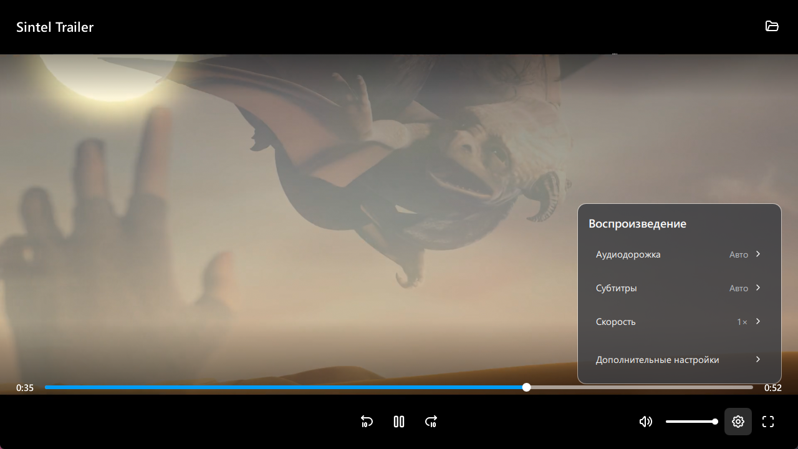

<p align="center">
  <strong>Русский</strong> / <a href="README.en.md">English</a>
</p>

<h1 align="center">qplay</h1>

<p align="center">
  Видеоплеер на основе <a href="https://mpv.io/">mpv</a>.
</p>

<p align="center">
  <a href="https://github.com/qbutt-org/qplay/releases/latest/download/qplay-setup.exe">
    
  </a>
  <a href="https://github.com/qbutt-org/qplay/releases">
    
  </a>
</p>

<p align="center">
  
  <a href="https://github.com/qbutt-org/qplay/releases/latest">
    
  </a>
  <a href="LICENSE">
    
  </a>
</p>

<p align="center">
  <a href="https://qbutt-org.github.io/qplay/">Сайт</a> /
  <a href="https://github.com/qbutt-org/qplay/releases/latest/download/qplay-portable.zip">Portable</a>
</p>

<p align="center">
  
  <br>
  <sub>Кадр из Sintel. © Blender Foundation / <a href="https://durian.blender.org/">durian.blender.org</a>, <a href="https://creativecommons.org/licenses/by/3.0/">CC BY 3.0</a>.</sub>
</p>

## Установка

### Windows

Запустите **qplay-setup.exe**. Поддерживаются Windows 10 версии 2004 и новее и Windows 11, x64. qplay появляется в меню «Пуск» и в списке приложений Windows.

Для portable-версии распакуйте **qplay-portable.zip** и запустите `qplay.exe`.

Установленная версия скачивает обновления в фоне и устанавливает их после закрытия всех окон плеера. Portable-версия обновляется вручную из настроек.

Откройте медиафайл или прямую ссылку в окне плеера. qplay появляется в меню Windows **Открыть с помощью** для распространённых форматов видео и аудио. Приложение не меняет выбранный вами плеер по умолчанию.

### Linux

Для Linux x64 нужны Ubuntu 24.04 или новее и glibc 2.39+. Выполните в терминале Linux или WSL:

```sh
curl -fsSL https://qbutt-org.github.io/qbutt/install.sh | sh -s -- qplay
```

После установки открывайте qplay из меню приложений или командой `~/.local/bin/qplay`.

Для ручной установки скачайте [qplay-linux-x64.tar.gz](https://github.com/qbutt-org/qplay/releases/latest/download/qplay-linux-x64.tar.gz), распакуйте и выполните `./qplay --install`. Команда `./qplay` без установки запускает переносимую версию с профилем в `userdata`.

Закройте плеер перед обновлением и повторите команду установки. Команда `~/.local/bin/qplay --uninstall` удаляет приложение, сохраняя настройки и данные воспроизведения.

## Управление и изображение

Кнопка параметров справа внизу открывает выбор аудиодорожки, субтитров и скорости. Там же доступны параметры обработки изображения. Апскейл зависит от видеокарты и самого видео; генерация кадров доступна только в Windows.

Субтитры можно выключить, выбрать из дорожек видео или добавить отдельным файлом. Плеер запоминает место остановки и продолжает просмотр при повторном открытии.

Для обычного воспроизведения достаточно установленного комплекта. В Windows плеер может автоматически скачать дополнительные компоненты генерации кадров.

## qbutt и qcatch

[qbutt](https://github.com/qbutt-org/qbutt) использует qplay для онлайн-видео и просмотра торрентных файлов во время загрузки. Установщик qbutt устанавливает этот же плеер.

[qcatch](https://github.com/qbutt-org/qcatch) находит видео в браузере и открывает выбранный поток в установленном qplay.

## Настройки

В Windows установленная версия хранит настройки в `%APPDATA%\qplay`, а кеш и подготовленные GPU-компоненты — в `%LOCALAPPDATA%\qplay`. В Linux используются XDG-каталоги: по умолчанию `~/.config/qplay`, `~/.local/share/qplay` и `~/.cache/qplay` для настроек, данных и кеша. Переносимая версия использует папку `userdata` рядом с приложением. Существующие настройки mpv и mpv.net не заменяются.

В расширенных настройках можно сменить язык и оформление, а также задать постоянную задержку звука относительно видео. Выбор обработки изображения сохраняется между запусками.

## Разработка

Нативный плеер находится в `src/native/`. QML отвечает за интерфейс, Rust — за сессию libmpv и настройки. Закреплённые зависимости и происхождение runtime записаны в `upstream-lock.json`.

Для локальной сборки нужны Qt 6.12, CMake, Rust из `rust-toolchain.toml` и Bun. В Windows также нужны MSVC и Inno Setup 6.7.3. Из Developer PowerShell соберите CMake target `qplay-native`, затем укажите каталог сборки:

```powershell
bun scripts/build.ts --native-build "C:\build\qplay-native" --installer-compiler "C:\tools\Inno Setup 6\ISCC.exe"
```

Скрипт проверяет исходную ревизию native build, пересобирает изменившиеся файлы, сверяет закреплённый runtime, развёртывает Qt/QML и создаёт установщик и portable-архив в `%TEMP%\qplay-build`. Параметры `--runtime-archive` и `--output` позволяют указать готовый архив и каталог результата.

В Linux `scripts/build-linux-runtime.ts` готовит закреплённый медиадвижок, а `scripts/build-linux.ts` упаковывает CMake-сборку в `qplay-linux-x64.zip`. Пакетирование принимает `--native-build`, `--linux-runtime` и `--qt-licenses`; каталог результата задаётся через `--output`. Полные исходники runtime собирает `scripts/build-linux-sources.ts`.

Команды `qplay --version-json` и `qplay --runtime-info-json` возвращают метаданные для интеграций; в Windows имя файла — `qplay.exe`. Плеер принимает путь к файлу или URL отдельным аргументом.

См. [правила проекта](AGENTS.md).

## Лицензии и происхождение

Комплект включает Qt-интерфейс, шейдеры и медиазависимости с уведомлениями авторов. Лицензии находятся в [licenses/](licenses/), а условия исходников qplay — в [LICENSE](LICENSE).

Исходники qplay доступны в Git-теге соответствующего выпуска. Точные исходники медиадвижка и его зависимостей вынесены в отдельный технический релиз, ссылка на который находится в описании выпуска.
